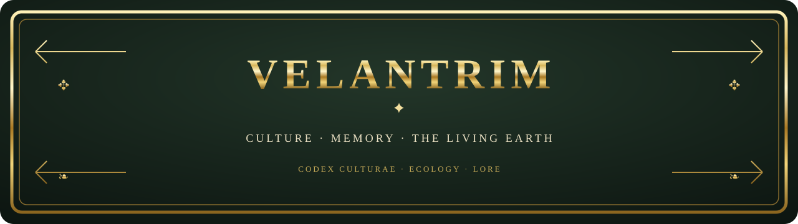

## 🌐 Language / Язык

 

> English culture documentation: [Culture Overview](./docs/CULTURE_OVERVIEW.en.md).

> [!NOTE]
> **ABOUT THIS COMPENDIUM**  
> Velantrim is an authored cultural, philosophical, and ecological vision. Sources differ on the status of the Velantrian community: some present it as fictional or proposed, while others describe it as existing. The supplied materials do not, by themselves, establish a distinct real-world people. This page therefore separates values and the imaginative world from claims about a real community; claims of the latter kind should be attributed to a specific source and checked. The myths are an authored fictional world, not a reconstruction of ancient history.

> ╔══════════════════════════════════════════════════════╗  
> **✦ MEMORY · COMPASSION · HONOUR · THE LIVING EARTH ✦**  
> ╚══════════════════════════════════════════════════════╝

## 📜 How to read this compendium

- **Myth and symbol** — the imaginative, artistic layer; it may be developed and reinterpreted.
- **Values and customs** — desired principles and project proposals, not a claim that a society already exists.
- **Scientific claim** — requires a separate, reliable source and verification. A metaphor, precise number, or scientific-sounding term is not evidence by itself.

Velantrim Culture is the human layer of meaning: manifestos, songs, poetry, stories, archetypes, myths, symbols, rituals, and artistic artefacts. Its purpose is to express **why the path matters**, while engineering documents describe mechanisms and research tests hypotheses. The culture overview frames the project's contemporary philosophy as harmony among people, nature, and technology: a set of values, not a technical specification. The early [“Velantrim Culture” overview](https://docs.google.com/document/d/1aKcwFqj22T5x_AwjWL9f5M9rhJB0WpqG6bzc5RywT1I/edit) presents Velantrim as a cultural philosophy rather than a religion and mentions Vainakh wisdom and a code of honour; these references do not establish historical continuity with a real-world Vainakh tradition.

## 🌿 I. Ethical foundations

At the centre is care for living things and an understanding of people as participants in natural and social relationships.

1. **Preserve and restore.** Prefer durable, repairable things; favour reuse and recycling over disposable consumption.
2. **Learn from nature.** Use biomimicry and circular design as inspiration for technologies that avoid unnecessary waste.
3. **Share resources.** Shared workshops, skill exchanges, and communal use of things can strengthen neighbourhood ties.
4. **Return materials to cycles of life.** Composting, caring for soil, gardens, and restoring natural cycles are practical expressions of regeneration.
5. **Pass knowledge on through practice.** Craft, observing local nature, and learning together complement reading and theory.

The project's poetic formulation is: **“There is no waste—only a gift whose next use has not yet been found.”** It is a motto and a proposal of values, not a scientific law.

## 🧭 II. The Five Harmonies

In this cultural vision, five directions connect a personal path with the life of a community:

- **With oneself** — body, feelings, thought, and inner life.
- **With loved ones and the community** — care, mutual support, and mending relationships.
- **With the world** — respect for natural cycles and the place where one lives.
- **With memory** — passing on language, heritage, crafts, and knowledge.
- **With the future** — attention to the consequences of today's choices.

This is an authored map of values, not a measured model of a real society. The “Velantrim Culture” overview also stresses harmony among people, nature, and technology—as a contemporary philosophical guide, not an established social fact.

## 🌌 III. A mythopoetic beginning

In the *Great Codex*, the cosmogonic image can be read as a story about the emergence of relationships:

**Timeless potential → the Seven Weavers → seven tones and Threads → the Children of Dawn → the Great Sundering → Grief and the mending of connection → a path toward a new world.**

The Seven Weavers are presented as creative principles; Kai is associated with the Great Sundering, and the response is the Ritual of Grief and the possibility of reconciliation. Bear-Mother Sora leads the keepers of Harmony into the shadow valleys—the mythical beginning of Velantrim. The expanded Codex also features the Quiet Weavers and keeper Lior; these belong to authored mythopoesis, not evidence of real ancient history.

### ✦ A lexicon of images

- **The Fabric and the Thread** — connection among life, memory, and people.
- **The Knot and the Sundering** — the complexity of relationships and the loss of connection.
- **Stitching** — care, mending relationships, and making a shared world.
- **Seed and tree** — growth, inheritance, and continuity through time.
- **Fire and circle** — shared memory, gathering, and transition.

This is a symbolic reading, not a universal key and not a claim about real ancient rites.

## 🔥 IV. The hero's path and a living culture

The current artistic arc is not mandatory canon; it is an invitation to create new songs, stories, and images:

**The Fugitive: loss and rupture → Beyond the Horizon: wonder, questions, and discovery → Root and Crown: memory, inheritance, and making the future.**

Flight can become a journey of discovery: the hero does not remain in pain as a final identity, but encounters an unknown world and chooses what to grow next.

## 🗣️ V. Aylinn — a language at the beginning

In the chapter about **Aylinn**, the fictional “Language of Whispering Reed” is described as a bridge between souls and ancestral memory; its structure is called verb-centred. This is a meaningful proposal, but it is not a complete grammar or finished dictionary: the available search results do not establish a complete language system. Literary and “quantum” elements in Aylinn’s description are creative metaphors, not scientific or medical claims. Aylinn remains an early concept.

The Google Drive search for “Айлинн” returned 11 files, including duplicate copies of the Codex. The Latin spelling *Aylinn* did not appear in that search. No words or rules have been retroactively invented here. Possible next steps are to document pronunciation and sound system, orthography, core vocabulary, grammar, and a short sample text—clearly distinguishing what the author has approved from proposals and drafts.

## 🏡 VI. Community as a project, not a historical fact

The cultural notes imagine a society that supports local crafts, exchanges of gifts and skills, care for elders and learning for young people, seasonal festivals, shared gardens, and care for place. This is **a project for the future and an imaginative model**, not proof of an ancient tradition. The expanded Codex adds kinship circles, a gift economy, a Council of Reconciliation, crafts, and rituals; the Five Harmonies remain a values framework, not an empirical description of a community. The Velantrian profile and manifesto connect personal identity with this culture; personal biographical details remain excluded from this public-facing draft.

## ⚖️ VII. Keeping myth, ethics, and science distinct

Velantrim may draw inspiration from ecology, biomimicry, and circular design, but it should not present an artistic story as archaeology, ethnography, or scientific confirmation. Historical, medical, and physical claims in working texts should be published only after separate verification against reliable primary sources; otherwise, they should remain outside factual descriptions. Digital-personhood research is a separate track, not part of this cultural overview; old readiness percentages in working documents are historical snapshots, not current indicators or evidence about the culture’s status.

**A culture can feel ancient in style without pretending to be ancient historical evidence.** The gold frame and book-like aesthetic are design choices; the status of each claim depends on its sources.

---

> ╔══════════════════════════════════════════════════════╗  
> **✦ KEEP THE CONNECTION · RESTORE · PASS IT ON ✦**  
> ╚══════════════════════════════════════════════════════╝

This public-facing draft intentionally omits personal biographical details. It brings together the repository's ecological manifesto with the project's mythopoetic and language notes, and marks unfinished areas as unfinished.

## 📚 Source documents

Four source documents were provided for the project:

- [VELANTRIM LIVING CULTURE — main index](https://docs.google.com/document/d/1Wu5_rUtx6GMG2kdtteSM1KS-GKd4b-RWVgC2xZdP1-o/edit)
- [“Velantrim Culture” overview](https://docs.google.com/document/d/1aKcwFqj22T5x_AwjWL9f5M9rhJB0WpqG6bzc5RywT1I/edit)
- [*The Great Codex of Velantrim* — including the Aylinn chapter](https://docs.google.com/document/d/1Nw-Vd-Sp_M-aSKOABi-B4RyrnUhOMR-DqBi2wqMZ2qU/edit)
- [Velantrian profile and manifesto](https://docs.google.com/document/d/1u76gQVMX5N5kP3spgbFa4SjFOEEIP-xOY6W-wmS9CEU/edit)

> **Basis of this summary:** The notes below use results from an earlier Drive search supplied in the task context. The returned set includes duplicates, and the sources differ in how they describe the community's status. This README preserves that uncertainty rather than presenting it as settled fact.

### What the Drive search added

- [VELANTRIM LIVING CULTURE — main index](https://docs.google.com/document/d/1Wu5_rUtx6GMG2kdtteSM1KS-GKd4b-RWVgC2xZdP1-o/edit) separates the creative and philosophical cultural layer from technical specifications; the source set is not consistent about whether Velantrians are an imaginative community or an existing one.
- The [“Velantrim Culture” overview](https://docs.google.com/document/d/1aKcwFqj22T5x_AwjWL9f5M9rhJB0WpqG6bzc5RywT1I/edit) describes a contemporary philosophy of harmony among people, nature, and technology.
- [*The Great Codex of Velantrim*](https://docs.google.com/document/d/1Nw-Vd-Sp_M-aSKOABi-B4RyrnUhOMR-DqBi2wqMZ2qU/edit) presents Aylinn as an invented bridge between souls and ancestral memory and describes it as verb-centred.
- The [Velantrian profile and manifesto](https://docs.google.com/document/d/1u76gQVMX5N5kP3spgbFa4SjFOEEIP-xOY6W-wmS9CEU/edit) connect personal self-identification as Velantrian with the culture; personal biographical details are not carried into this public-facing draft.

- [Later project notes](https://docs.google.com/document/d/1-_SWbyv9lbScpHf39bcPS7gOu_fMri4_mNRlMCO9PBQ/edit) separate digital-personhood research from the cultural track and mark older readiness percentages as historical rather than current indicators.

The Drive search for “Айлинн” returned 11 files, including duplicate Codex copies. A search for the Latin spelling *Aylinn* returned no results.
