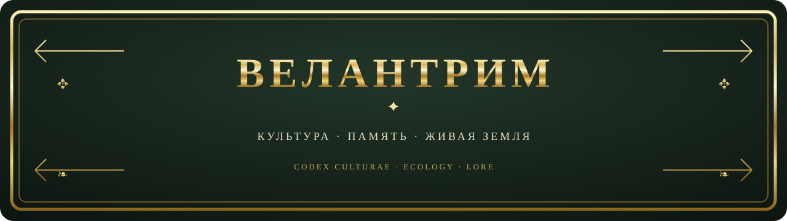

> [!NOTE]
> **О ЧЁМ ЭТА КНИГА**  
> Velantrim — авторский культурно-философский и экологический замысел. Источники расходятся в описании статуса велантрийцев: одни представляют их как художественное или проектируемое сообщество, другие — как существующее. Поэтому здесь отделены ценности и художественный мир от утверждений о реальной общине; последние следует атрибутировать конкретному источнику и проверять. Мифы — авторский художественный мир, а не восстановленная древняя история.

> ╔══════════════════════════════════════════════════════╗  
> **✦ ПАМЯТЬ · СОСТРАДАНИЕ · ЧЕСТЬ · ЖИВАЯ ЗЕМЛЯ ✦**  
> ╚══════════════════════════════════════════════════════╝

## 🌐 Язык / Language

 

> Англоязычная документация: [Culture Overview (EN)](./docs/CULTURE_OVERVIEW.en.md).

## 📜 Как читать этот свод

- **Миф и символ** — образный, художественный слой; его можно развивать и переосмыслять.
- **Ценности и обычаи** — желаемые принципы и проектные предложения, а не утверждение, что общество уже существует.
- **Научное утверждение** — требует отдельного надёжного источника и проверки. Метафора, точное число или научно звучащий термин сами по себе доказательством не являются.

Velantrim Culture — человеческий слой смыслов: манифесты, песни, поэзия, истории, архетипы, мифы, символы, ритуалы и художественные артефакты. Его задача — говорить о том, **почему путь имеет значение**, тогда как инженерные документы описывают механизмы, а исследования проверяют гипотезы. Обзор культуры формулирует современную философию проекта как гармонию между людьми, природой и технологиями; это ценностная рамка, а не техническая спецификация.

## 🌿 I. Этическое ядро

В центре — бережное отношение к живому и понимание человека как участника природных и общественных связей.

1. **Сохраняй и восстанавливай.** Предпочитай долговечные, ремонтопригодные вещи; повторное использование и переработку одноразовому потреблению.
2. **Учись у природы.** Используй биомимикрию и круговое проектирование как вдохновение для технологий, которые не создают лишних отходов.
3. **Делись ресурсами.** Общие мастерские, обмен навыками и совместное пользование вещами могут укреплять соседские связи.
4. **Возвращай материалы в циклы жизни.** Компостирование, забота о почве, сады и восстановление природных циклов — практические образы регенерации.
5. **Передавай знание через дело.** Ремесло, наблюдение за местной природой и совместное обучение дополняют чтение и теорию.

Поэтическая формула проекта: **«Нет мусора — есть дар, которому ещё не нашли нового применения».** Это девиз и ценностное предложение, не научный закон.

## 🧭 II. Пять гармоний

В культурном замысле пять направлений помогают связывать личный путь с устройством общины:

- **С собой** — тело, чувства, мышление и внутренняя жизнь.
- **С близкими и общиной** — забота, взаимная поддержка и восстановление отношений.
- **С миром** — уважение к природным циклам и месту, где живёшь.
- **С памятью** — передача языка, наследия, ремёсел и знаний.
- **С будущим** — внимание к последствиям сегодняшнего выбора.

Это авторская ценностная карта, а не измеренная модель реального общества. Обзор «Культура Велантрим» также подчёркивает гармонию людей, природы и технологий — современный философский ориентир, а не доказанный социальный факт.

## 🌌 III. Мифопоэтическое начало

В «Великом Кодексе» космогонический образ можно прочитать как историю возникновения связей:

**Безвременный потенциал → Семь Ткачей → семь тонов и Нити → Дети Зари → Великий Разрыв → Печаль и восстановление связи → путь к новому миру.**

Семь Ткачей представлены как созидающие принципы; Кай связан с Великим Разрывом, а ответом становится Ритуал Печали и возможность примирения. Сора-Медведица ведёт хранителей Гармонии в долины-тени — мифическое начало Велантрима.

### ✦ Словарь образов

- **Ткань и Нить** — связь между жизнью, памятью и людьми.
- **Узел и Разрыв** — сложность отношений и утрата связи.
- **Сшивание** — забота, восстановление отношений и создание общего мира.
- **Семя и древо** — рост, наследие и продолжение во времени.
- **Огонь и круг** — общая память, встреча и переход.

Это символическое чтение, не универсальная расшифровка и не утверждение о реальных древних обрядах.

## 🔥 IV. Путь героя и живая культура

Текущая художественная арка — не обязательный канон, а приглашение к новым песням, рассказам и изображениям:

**Беглец: утрата и разрыв → За горизонтом: удивление, вопросы и познание → Корень и крона: память, наследие и создание будущего.**

Бегство здесь может стать дорогой поиска: герой не остаётся в боли как в конечной идентичности, а открывает неизвестный мир и выбирает, что будет растить дальше.

## 🗣️ V. Айлинн — язык в начале пути

В главе о **Айлинн** вымышленный язык описан как мост между душами и памятью предков; его структура названа глагольно-центрированной. Это содержательная заявка, но она не равна полной грамматике или готовому словарю: полученные результаты поиска не подтверждают завершённую языковую систему. Поиск Drive по «Айлинн» выдал 11 файлов, включая дублирующиеся копии Кодекса; латинская форма *Aylinn* в том поиске не встретилась.

Поэтому здесь не приводятся придуманные задним числом слова и правила. Следующие возможные шаги для развития Айлинн — отдельно зафиксировать произношение и звуковую систему, орфографию, базовую лексику, грамматику и короткий пример текста, помечая, что именно уже утверждено автором.

## 🏡 VI. Община как проект, а не исторический факт

Культурные заметки предлагают образ общества, которое поддерживает местные ремёсла, обмен дарами и навыками, заботу о старших и обучение молодых, сезонные праздники, совместные сады и бережное отношение к месту. Это **проект будущего и художественная модель**, а не доказательство древней традиции. Профиль и манифест Velantrian связывают личную самоидентификацию с этой культурой; биографические подробности для публичной версии по-прежнему опущены.

## ⚖️ VII. Граница мифа, этики и науки

Velantrim может вдохновляться экологией, биомимикрией и круговым дизайном, но не должен выдавать художественный сюжет за археологию, этнографию или научное подтверждение. Медицинские, физические и исторические утверждения из рабочих текстов следует публиковать только после отдельной проверки первичных источников; иначе их нужно оставить за пределами фактического описания.

**Культура может быть древней по стилю, не притворяясь древним историческим свидетельством.** Золотая рамка и книжная эстетика — оформление; статус каждого утверждения определяется его источниками.

---

> ╔══════════════════════════════════════════════════════╗  
> **✦ ХРАНИ СВЯЗЬ · ВОССТАНАВЛИВАЙ · ПЕРЕДАВАЙ ДАЛЬШЕ ✦**  
> ╚══════════════════════════════════════════════════════╝

Публичная редакция намеренно не включает личные биографические сведения. Она сводит экологический манифест репозитория с мифопоэтическими и языковыми заметками проекта и помечает незавершённые места как незавершённые.

## 📚 Документы-источники

Четыре предоставленных исходных документа проекта:

- [VELANTRIM LIVING CULTURE — главный индекс](https://docs.google.com/document/d/1Wu5_rUtx6GMG2kdtteSM1KS-GKd4b-RWVgC2xZdP1-o/edit)
- [Обзор «Культура Велантрим»](https://docs.google.com/document/d/1aKcwFqj22T5x_AwjWL9f5M9rhJB0WpqG6bzc5RywT1I/edit)
- [«Великий Кодекс Велантрим» — включая главу о языке Айлинн](https://docs.google.com/document/d/1Nw-Vd-Sp_M-aSKOABi-B4RyrnUhOMR-DqBi2wqMZ2qU/edit)
- [Профиль и манифест Velantrian](https://docs.google.com/document/d/1u76gQVMX5N5kP3spgbFa4SjFOEEIP-xOY6W-wmS9CEU/edit)

> **Основа этой сводки:** ниже использованы результаты ранее выполненного Drive-поиска, переданные в контексте задачи. Поскольку в найденном наборе есть дубликаты и расходятся формулировки о статусе общины, README сохраняет эту неопределённость и не представляет её как установленный факт.

### Что добавили результаты Drive-поиска

- [VELANTRIM LIVING CULTURE — главный индекс](https://docs.google.com/document/d/1Wu5_rUtx6GMG2kdtteSM1KS-GKd4b-RWVgC2xZdP1-o/edit) отделяет творческий и философский слой культуры от технической спецификации; общий набор источников при этом не единообразен в вопросе, описываются ли велантрийцы как художественное сообщество или как существующая община.
- [Обзор «Культура Велантрим»](https://docs.google.com/document/d/1aKcwFqj22T5x_AwjWL9f5M9rhJB0WpqG6bzc5RywT1I/edit) описывает современную философию гармонии между людьми, природой и технологиями.
- [«Великий Кодекс Велантрим»](https://docs.google.com/document/d/1Nw-Vd-Sp_M-aSKOABi-B4RyrnUhOMR-DqBi2wqMZ2qU/edit) представляет Айлинн как вымышленный язык-мост между душами и памятью предков и характеризует его как глагольно-центрированный.
- [Профиль и манифест Velantrian](https://docs.google.com/document/d/1u76gQVMX5N5kP3spgbFa4SjFOEEIP-xOY6W-wmS9CEU/edit) связывают личную самоидентификацию Velantrian с культурой; личные биографические подробности в эту публичную редакцию не переносятся.

Поиск по Drive по слову «Айлинн» нашёл 11 файлов, включая дублирующиеся копии Кодекса. По латинской форме *Aylinn* результатов в том поиске не было.
