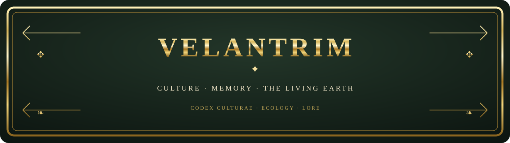

## 🌐 Language / Язык

 

# Velantrim Culture — Cultural Core and the Aylinn Language

> **A synthesis of materials from Notion, GitHub, and Google Drive.** Velantrim is presented as an authored cultural, philosophical, and ecological vision. Sources differ on whether the Velantrian community is fictional or proposed, or is described as existing. The supplied materials do not, by themselves, establish a distinct real-world people. This overview separates values and the mythopoetic world from claims about a real community; claims about real-world status should be attributed to a specific source. The myths are not presented as recovered ancient history.

## What “Velantrim Culture” means

The [VELANTRIM LIVING CULTURE page](https://app.notion.com/p/3d7ac84d05478132a664f023d7df04a8) distinguishes culture from technical architecture. Culture is the human layer of meaning—songs, manifestos, stories, archetypes, myths, symbols, rituals, and creative artefacts. Its role is to live and pass on meaning, not to act as a specification for a software core.

## Values and an imagined community

The ecological manifesto in the [velantrim-culture repository](https://github.com/velantrian/velantrim-culture) emphasizes circular cycles, biomimicry, repair and reuse, sharing resources, restoring natural cycles, caring for soil, and learning through practice.

The “Velantrim Culture” overview describes a contemporary philosophy of harmony among people, nature, and technology. This is a philosophical guide for the project, not a technical description or an established social fact. The early overview frames Velantrim as cultural philosophy rather than religion and mentions Vainakh wisdom and a code of honour; these references do not establish historical continuity with a real-world Vainakh tradition.

Cultural notes connect a personal path with five harmonies: with oneself; with loved ones and community; with the natural world; with memory; and with the future and the consequences of choices. These are authored guides and a proposal for the future—not a claim that such a community already exists.

The [Velantrian profile and manifesto](https://docs.google.com/document/d/1u76gQVMX5N5kP3spgbFa4SjFOEEIP-xOY6W-wmS9CEU/edit) connect personal self-identification as Velantrian with the culture. This overview does not repeat personal biographical details.

## The mythopoetic layer

The [mythology and Aylinn overview in Notion](https://app.notion.com/p/3eeac84d0547816aa4b1d685ff8edbfd) describes an authored cosmogony: the Seven Weavers create seven tones and the Threads; the Children of Dawn appear; Kai is associated with the Great Sundering; and Grief becomes a response and a possibility for restoring connection. Bear-Mother Sora leads the keepers of Harmony into the shadow valleys—the mythical beginning of Velantrim. The expanded Codex also features the Quiet Weavers and keeper Lior; these belong to authored mythopoesis, not evidence of real ancient history.

Images of the Fabric, Thread, Knot, and Sundering lead into an ethic of connection and restoration; seed, tree, fire, and circle expand the symbolic vocabulary. This is a symbolic reading, not evidence of real ancient rites.

The artistic arc of Living Culture—**The Fugitive → Beyond the Horizon → Root and Crown**—moves from loss and rupture through questions and discovery toward memory, inheritance, and creating the future. The Living Culture page describes this as a working artistic frame, not mandatory canon.

## Aylinn: an invented language in its early stages

In a chapter of *The Great Codex of Velantrim*, Aylinn—the fictional “Language of Whispering Reed”—is described as a bridge between souls and ancestral memory, and as verb-centred. These are meaningful thematic and structural characteristics, but they do not mean a complete dictionary or grammar already exists; the language remains an early concept.

A Google Drive search for “Айлинн” returned 11 files, including duplicate copies of the Codex. The Latin spelling *Aylinn* did not appear in that search. Literary and “quantum” elements in Aylinn’s description are creative metaphors, not scientific or medical claims. Further development could document pronunciation, writing system, vocabulary, and grammar separately, while distinguishing author-approved material from proposals and drafts.

## Expanded Codex: myth and community

The expanded Codex develops the cultural vision through kinship circles, a gift economy, a Council of Reconciliation, crafts, and rituals. It also describes the Five Harmonies. These are authored values and proposed or mythopoetic forms, not empirical evidence about a real community or proof of ancient customs.

## Keeping the status of claims clear

- Myth and artistic symbolism belong to the creative world.
- Values and community practices are desired principles or proposals.
- Sources differ on whether the Velantrian community is presented as a fictional project or as existing; claims about its real-world status should be attributed to a source and checked.
- Historical, medical, and scientific claims require separate reliable sources and verification. Literary or “quantum” language in Aylinn is creative, not a scientific or medical claim.
- Digital-personhood research is a separate track from cultural documentation; older readiness percentages in working documents are historical snapshots, not current indicators.
- The old-book aesthetic is an artistic design choice, not a claim of ancient origin.

## Working-space sources

- [VELANTRIM LIVING CULTURE — living culture](https://app.notion.com/p/3d7ac84d05478132a664f023d7df04a8) — the distinction between culture and the technical project, themes, and story arc.
- [Mythology, symbols, and Aylinn overview](https://app.notion.com/p/3eeac84d0547816aa4b1d685ff8edbfd) — the mythopoetic material and the incomplete description of Aylinn.
- [GitHub: velantrian/velantrim-culture](https://github.com/velantrian/velantrim-culture) — the repository's ecological manifesto.

## Google Drive source documents

The notes below reflect earlier Drive search results supplied for this task. The returned set includes duplicates, and the sources differ in how they describe the community's status.

- [VELANTRIM LIVING CULTURE — main index](https://docs.google.com/document/d/1Wu5_rUtx6GMG2kdtteSM1KS-GKd4b-RWVgC2xZdP1-o/edit) — culture as a creative and philosophical domain, separate from technical specifications.
- [“Velantrim Culture” overview](https://docs.google.com/document/d/1aKcwFqj22T5x_AwjWL9f5M9rhJB0WpqG6bzc5RywT1I/edit) — a contemporary philosophy of harmony among people, nature, and technology.
- [*The Great Codex of Velantrim*](https://docs.google.com/document/d/1Nw-Vd-Sp_M-aSKOABi-B4RyrnUhOMR-DqBi2wqMZ2qU/edit) — the Aylinn chapter describing an invented, verb-centred bridge between souls and ancestral memory.
- [Velantrian profile and manifesto](https://docs.google.com/document/d/1u76gQVMX5N5kP3spgbFa4SjFOEEIP-xOY6W-wmS9CEU/edit) — personal self-identification as Velantrian and its connection with the culture; personal biographical details are not repeated here.
- [Later project notes](https://docs.google.com/document/d/1-_SWbyv9lbScpHf39bcPS7gOu_fMri4_mNRlMCO9PBQ/edit) — separate digital-personhood research from culture and mark older readiness percentages as historical, not current.

This overview brings together cultural information and sources without reproducing personal biography or presenting the artistic layer as historical evidence. It is an English-language companion to the [Notion culture overview](https://app.notion.com/p/40aac84d054781379279d972f8c2f134?pvs=204).
